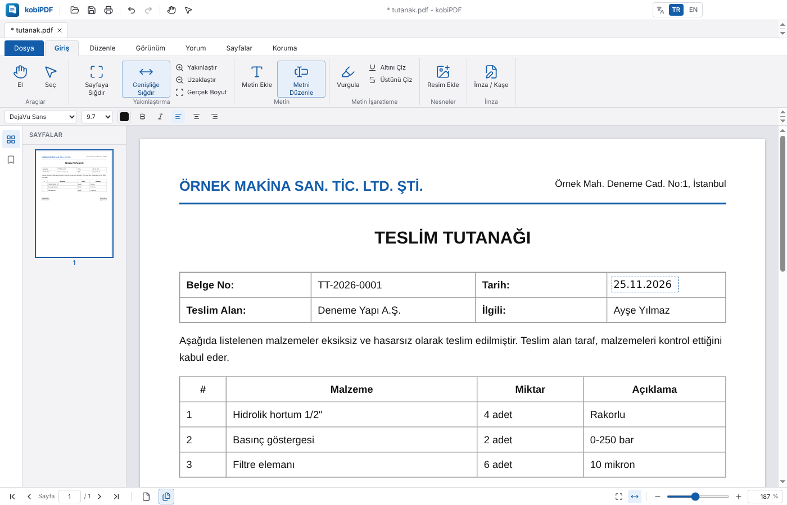

# kobiPDF

Hidroteknik'ten emek dünyasına armağan: ücretsiz, çevrimdışı çalışan masaüstü PDF görüntüleyici ve düzenleyici. Electron, React, TypeScript ve TailwindCSS ile yazılmıştır.



İlk sürümü Serkan Yavuz Mercan'ın PDFPro projesine dayanır.

## Bu sürümde

- Açık bir PDF dururken başka bir dosya yeni sekmede açılır; her sekmede dosya adı ve kapatma işareti vardır.
- Metin aracında Windows’taki Arial, Times New Roman ve benzeri yüklü yazı tipleri kullanılabilir.
- Yazı yazarken imleç yanıp sönüyorsa kutu taşınabilir.
- Altını çiz ve üstünü çiz araçlarında çizgi kalınlığı seçilir.
- İmza penceresinden resim yüklenebilir; saydam arka planlı PNG belgede saydam kalır.
- Vurgula aracı fosforlu kalem gibi serbest çizim yapar; uç kalınlığı ayarlanır.
- Yazdırma önizlemesi uygulama içinde açılır.
- Logoya tıklayınca Hakkında penceresi açılır.
- Tek örnek: uygulama açıkken ikinci kez başlatılırsa mevcut pencere öne gelir.
- Foxit tarzı şerit menü: Dosya, Giriş, Düzenle, Görünüm, Yorum, Sayfalar, Koruma.
- Türkçe ve İngilizce arayüz (başlıktaki TR / EN).
- Sayfa küçük resimleri, yer imleri, sürekli veya tek sayfa görünümü, sayfaya gitme.
- Yakınlaştırma: kaydırıcı, yüzde, sayfaya sığdır, genişliğe sığdır, Ctrl + fare tekerleği.
- El aracı ile sürükleyerek kaydırma.
- Metin ekleme ve mevcut metni düzenleme (Türkçe karakter destekli).
- Resim ekleme, nesne taşıma / boyutlandırma.
- Vurgu, altını çiz, üstünü çiz, kalem, silgi, yapışkan not, yorum kutusu.
- Sayfa döndürme, silme, sürükleyerek sıralama, çıkarma, birleştirme ve bölme.
- İmza çizme veya resim imza yerleştirme.
- Geri al / yinele ve kaydedilmemiş değişiklik uyarısı.

## Geliştirme

```bash
npm install
npm run dev
```

Windows kurulumu:

```bash
npm run dist:win
```

Çıktı `release/` altındadır. macOS için `npm run dist:mac` bir Mac üzerinde çalıştırılır.

## Lisans

© 2026 Hidroteknik. GNU Affero Genel Kamu Lisansı sürüm 3 (AGPL-3.0) ile dağıtılır. Ayrıntı için `LICENSE` dosyasına bakın.
